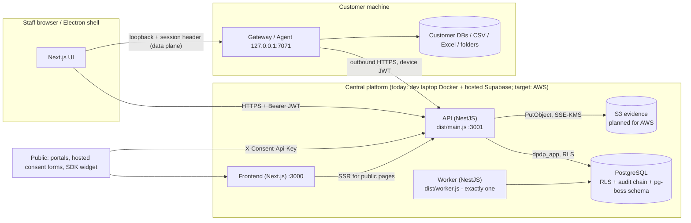
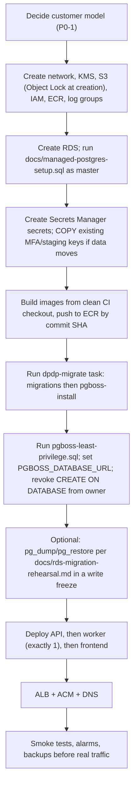
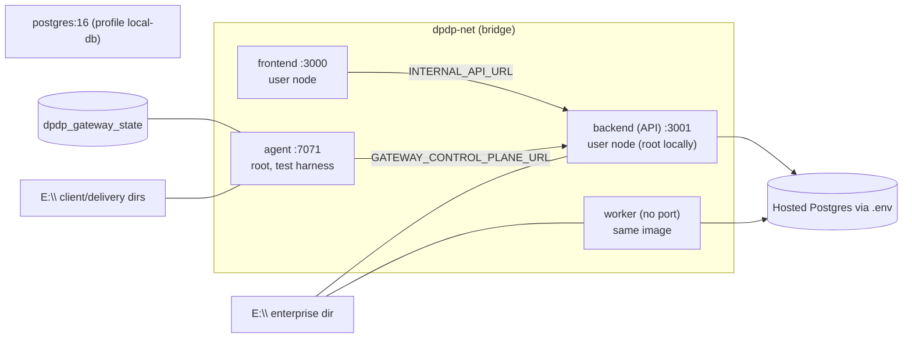

# DPDP Platform — Complete Technical Handoff

> **Deployment — read this first.** The authoritative, current deployment is
> the single EC2 server in Asia Pacific (Sydney), `ap-southeast-2`:
> [`deploy/single-server/README.md`](deploy/single-server/README.md). Sections below that describe ECS/Fargate,
> ALB, RDS, `ap-south-1` (Mumbai) or `deploy/aws/` record the superseded
> design and are kept for history.

Prepared 2026-11-06 by inspecting the repository at `E:\DPDP ACT\DPDP-ACT`.
Nothing was modified except this file. No secret values appear in it.

**How to read this.** Every statement is tagged by how I know it:

- **[code]** read in the current source, this session.
- **[doc]** stated in a repository document I did not cross-check against code.
- **[ran]** a command I executed (date given).
- **[unverified]** I could not check it; do not rely on it.
- **[rec]** my recommendation, not something that exists.

Three repository documents are **stale and must not be trusted** for architecture (see §13): `CLAUDE.md` (says Redis/BullMQ and "two containers"), `docs/DPDP_Locked_Target_Architecture.md` (says no cloud SDK; says customer installs call a provider API), and parts of `docs/DPDP_Platform_Master_Build_Document.md`.

---

## 1. Executive summary

DPDP is a **compliance operating system for India's DPDP Act**: a multi-tenant web application where organisations (Data Fiduciaries) keep their data inventory, consent records, data-principal rights requests, grievances, breach register, retention tracking and an audit trail. Its core promise is that the **platform stores metadata and compliance evidence, not customers' business data** [code: `CLAUDE.md` invariants, enforced by `data_sources` Mode A/B and structural guard specs].

What exists today [code]:

- A **NestJS API** and a **separate NestJS worker** (same image, different command), a **Next.js** frontend, a localhost **Gateway/Agent** process, and a **Consent SDK** served by the API.
- **One PostgreSQL database** with row-level security (RLS) on every tenant table, hash-chained audit log, and a job queue (pg-boss) living inside the same database. **No Redis, no Kafka.**
- Two **customer-side installers** for Windows: a Docker-based full-stack installer (`installer/`, `desktop/`) and a lightweight Gateway-only Windows service installer (`gateway-installer/`, `gateway-app/`).
- AWS preparation: ECS Fargate task/service JSON templates, an RDS-verified-TLS database layer, an S3 evidence store, a single-worker lock, pg-boss least-privilege SQL (written, not applied), runbooks, and an RDS migration rehearsal plan. **Nothing has been deployed and no AWS resource exists.**

The most important thing a reviewer needs to know: **the full-stack customer installer connects each customer machine directly to the central database with the central runtime credential and the central encryption keys** (§7, §11 P0-1). That conflicts with the AWS plan (private RDS) and with tenant isolation, and it needs an architectural decision before production.

---

## 2. Repository structure and stack

pnpm workspace + Turborepo [code: `pnpm-workspace.yaml`, `turbo.json`]. Node 22.17.0 pinned in Dockerfiles; `package.json` engines say `>=20.11`; pnpm 9.12.0 via `packageManager`.

| Path                 | Package             | Responsibility                                                           | Key libraries                                                                                         |
| -------------------- | ------------------- | ------------------------------------------------------------------------ | ----------------------------------------------------------------------------------------------------- |
| `backend/`           | `@dpdp/api`         | API (`dist/main.js`) and worker (`dist/worker.js`), migrations           | NestJS, `pg`, `pg-boss`, `node-pg-migrate`, `jsonwebtoken`, `exceljs`, `pdfkit`, `@aws-sdk/client-s3` |
| `frontend/`          | `@dpdp/web`         | Next.js app (staff dashboard, public portals, platform-admin tool)       | Next, React, `qrcode`, `xlsx`                                                                         |
| `shared/`            | `@dpdp/shared`      | Types, enums, Gateway contract constants (no runtime deps)               | TypeScript                                                                                            |
| `agent/`             | `@dpdp/agent`       | Gateway/Agent: localhost data plane + outbound control plane             | `undici`, `pg`, `mysql2`, `mssql`, `xlsx`                                                             |
| `sdk/`               | `@dpdp/consent-sdk` | Browser consent SDK + consent-form widget (esbuild)                      | esbuild                                                                                               |
| `desktop/`           | `@dpdp/desktop`     | Electron shell that starts the Docker runtime and opens the UI           | Electron                                                                                              |
| `gateway-app/`       | `@dpdp/gateway-app` | Electron "Gateway Setup" app (pairing, add sources, UAC helper)          | Electron                                                                                              |
| `installer/`         | —                   | Inno Setup + PowerShell for the Docker-based customer install            | PowerShell 5.1                                                                                        |
| `gateway-installer/` | —                   | Inno Setup + WinSW for the Windows-service Gateway                       | PowerShell, WinSW                                                                                     |
| `deploy/aws/ecs/`    | —                   | ECS task/service JSON templates (7 files)                                | —                                                                                                     |
| `docs/`              | —                   | Architecture, AWS, env, runbooks, SQL                                    | —                                                                                                     |
| `scripts/`           | —                   | Demos, e2e and Playwright specs, `rotate-jwt-secret.mjs`, `local-db.mjs` | Node, Playwright                                                                                      |

- **Language:** TypeScript throughout; Electron apps and scripts are plain JavaScript.
- **Database access:** raw SQL through `pg`; **no ORM** [code]. Migrations are hand-written SQL (58 files, §5).
- **Validation:** hand-written DTO parsers; **no class-validator** [code: not in `backend/package.json`].
- **Tests:** Jest (backend, agent), plain `node` test files (desktop, gateway-app), Playwright specs in `scripts/*.spec.mjs`.
- **Duplicate migration timestamp:** `1737002400000` is used by two files (`inventory-system-access-control-note`, `workflow-jobs-kind-status-index`). Fresh databases are fine; a database that already ran one can raise an ordering error (the rehearsal plan uses `--no-check-order`) [code, ran].

### Services and how they talk

| Service  | Responsibility                                                                                                       | Talks to                                                                   |
| -------- | -------------------------------------------------------------------------------------------------------------------- | -------------------------------------------------------------------------- |
| API      | All HTTP: staff APIs, public portals/forms, Gateway control plane, platform admin, serves SDK at `/consent-sdk/v1/*` | Postgres (`dpdp_app` pool + pg-boss), S3 (evidence), Postmark/MSG91        |
| Worker   | pg-boss consumers: deadline ticker, webhook delivery, retention, Enterprise server-storage sweep (30 s)              | Postgres, Postmark/MSG91, customer webhook URLs                            |
| Frontend | Staff UI; server-renders public pages (`/forms/[slug]`, `/portal/[slug]`)                                            | API (browser direct via `NEXT_PUBLIC_API_URL`; SSR via `INTERNAL_API_URL`) |
| Agent    | Local data plane (browser → `127.0.0.1:7071`) and outbound control plane                                             | API over HTTPS (device token); customer DBs/files                          |

External services [code]: **Postmark** (email), **MSG91** (SMS), optional generic HTTP notifier, customer-configured **webhooks** (HMAC-signed), **S3/KMS** for import evidence. There is no other third-party dependency.

---

## 3. Actual architecture

### Tenancy and isolation (S1/I3) [code]

1. A signed JWT carries `tenant_id`. `TenantContextMiddleware` verifies it and stores tenant/user/role in `AsyncLocalStorage`.
2. `TenantDatabaseService.runScoped` opens a transaction and runs `SELECT set_config('app.current_tenant', $1, true)`.
3. Every tenant table has `ENABLE` + `FORCE ROW LEVEL SECURITY` and a policy `tenant_id = app.current_tenant()` (helper `app.apply_tenant_rls`).
4. The runtime role `dpdp_app` is `NOSUPERUSER NOBYPASSRLS` and cannot own tables.
5. Pre-authentication lookups (login by email, portal slug, API key, form slug, Gateway enrolment code) use **non-RLS directory tables and `SECURITY DEFINER` functions** in schema `app` (`user_directory`, `org_directory`, `api_key_directory`, `consent_form_directory`, `gateway_enrollment_directory`), kept in sync by triggers.
6. **Important property:** RLS depends on a session variable that the _application_ sets. Anyone holding the `dpdp_app` credential and able to run SQL can set it to any tenant UUID. This is why handing that credential to customer machines is a P0 (§11).

### Customer onboarding, licences, capabilities [code]

- `POST /auth/register` (unauthenticated) creates the organisation (one org = one tenant), the five module areas, the Owner, **a licence (raw key shown once, only a hash stored)** and an MFA enrolment token.
- Licences (`licenses`): plan `saas|enterprise`, deployment type `hosted|client_server`, status, per-feature overrides. A flat **6-month validity placeholder** applies when no expiry is given (`licensing.service.ts`). Platform-admin-issued licences need platform-admin approval before activation (migration `5300000`).
- Installations (`installations`): `POST /installations` with a licence key; the server checks plan/deployment-type match. The frontend `ActivationGate` is shown only when built with `NEXT_PUBLIC_REQUIRE_ACTIVATION=true` (installer image).
- Capabilities: `GET /capabilities` → `{plan, deploymentType, features}` with keys `saas, enterprise, enterpriseGateway, databaseConnectors, localConnectors`. `@RequireCapability('enterpriseGateway')` is applied to Gateway and storage-gateway routes. Frontend hiding is UX only.

### Where data lives [code unless noted]

| Data                                                                                | Where                                                                                                                                     |
| ----------------------------------------------------------------------------------- | ----------------------------------------------------------------------------------------------------------------------------------------- |
| Orgs, users, roles, licences, installations, Gateway devices/sessions               | Central Postgres                                                                                                                          |
| Data-source **metadata**, inventory, purposes, systems, vendors, retention metadata | Central Postgres                                                                                                                          |
| Consent events (subject reference is an HMAC, per-tenant secret)                    | Central Postgres, append-only partitioned                                                                                                 |
| Tickets, breach incidents, audit log, notification metadata                         | Central Postgres                                                                                                                          |
| Customer database rows, files, field values                                         | Customer machine only; Mode B values transit the browser↔localhost agent path and are not persisted centrally                             |
| **Exception:** hosted-form submission payloads                                      | `consent_form_submission_deliveries`, AES-256-GCM encrypted, nulled on agent acknowledgement (documented narrow carve-out in `CLAUDE.md`) |
| Import evidence (declaration + file hash + row count, never rows)                   | `backend/var/` on local disk, or S3 when `IMPORT_EVIDENCE_STORE=s3`                                                                       |

**Does raw PII reach central infrastructure?** By design, no, with the one staging exception above. Structural guard specs (`raw-access-guard.spec.ts`, `frontend-raw-data-boundary.spec.ts`, `gateway-security-guard.spec.ts`) are intended to fail the build if a raw-read route appears [doc/code]. I did not audit every code path for leaks; the 2026-11-04 session did a live "PII canary" style check on earlier features, not on today's tree [unverified for current tree].

### Gateway/Agent architecture [code: `agent/`, `shared/src/gateway.ts`]

- **Control plane** (agent → API, outbound HTTPS): enrol, heartbeat, pairing redeem, session refresh, folder authorisation, submission-delivery claim/ack/fail, de-enrol.
- **Data plane** (browser → `http://127.0.0.1:7071` → agent → customer source): `/source/discover|search|read|metadata|fields|browse`, customer resolve/write/create, column create. Bounded reads: default 100, max 1000 rows. Navigation uses opaque folder handles; the browser never sends a path.
- **Local listener security:** loopback bind by default; exact-origin allowlist (no wildcards); `Host` must be loopback (DNS-rebinding defence); custom header `x-dpdp-gateway-session` forces CORS preflight; browsers get liveness only on `/health`.
- **Connectors:** `postgresql`, `mysql`, `sqlserver`, `csv`, `excel`, `filesystem` (`.csv` and `.xlsx` only). Structured operations only, never arbitrary SQL.
- **Credentials (Windows service):** device token, source passwords, proxy password encrypted with DPAPI by the service itself; hand-off files in a protected `state` directory.
- **Docker agent** (`agent/Dockerfile`, compose service `agent`) is a **test harness**, runs as root, binds `0.0.0.0`.

Enrolment-to-first-read flow [code]:

1. Staff create a one-time enrolment code (`POST /gateway/enrollments`, default TTL 900 s, hash stored) — requires capability `enterpriseGateway`.
2. Agent redeems it (`POST /gateway/enroll`) → receives a **device JWT** (HS256, 30-day default) and persists it (DPAPI on Windows).
3. Agent heartbeats every 60 s; the API returns the dashboard origins the agent should accept (`WEB_ORIGIN`).
4. Staff register a data source (metadata only, `data_access_mode=metadata_only`) and optionally switch it to `gateway_connected` (`PATCH /data-sources/:id/mode`, role-gated, audited).
5. For a raw view the browser asks for a pairing nonce (60 s), hands it to the local agent, the agent redeems it centrally and gets a 15-minute session, and the browser then reads through localhost.

### Desktop/Electron [code]

- `desktop/` is a thin shell: runs `installer\scripts\start.ps1` if the stack is unhealthy, waits on `:3001/health`, `:7071/health`, `:3000/`, then opens `http://localhost:3000`. Also exposes IPC for native folder dialogs and Enterprise storage file operations.
- `gateway-app/` never talks to the backend or sees a device token. Its only privileged path is a UAC-elevated PowerShell helper with four fixed actions (`pair`, `add-source`, `remove`, `restart`) using single-use request files.

---

## 4. Docker and containerisation

### Images (all in-repo, built from repo root)

| Image                               | Dockerfile            | Stages                       | Runs as           | Notes                                                                                                                                                                                              |
| ----------------------------------- | --------------------- | ---------------------------- | ----------------- | -------------------------------------------------------------------------------------------------------------------------------------------------------------------------------------------------- |
| backend (API + worker + migrations) | `backend/Dockerfile`  | `base` → `build` → `runtime` | `node` (uid 1000) | Node 22.17.0-bookworm-slim; builds shared, SDK, API; prod deps only; copies `backend/migrations`; adds RDS CA bundle `/opt/dpdp/certs/rds-global-bundle.pem` via `ADD --checksum` (SHA-256 pinned) |
| frontend                            | `frontend/Dockerfile` | same shape                   | `node`            | `NEXT_PUBLIC_API_URL` and `NEXT_PUBLIC_REQUIRE_ACTIVATION` are **build args baked into the bundle** — one image per environment                                                                    |
| agent                               | `agent/Dockerfile`    | same shape                   | **root**          | Test harness only                                                                                                                                                                                  |

All three set `HEALTHCHECK` (Node `fetch`), PID 1 is `node` directly (SIGTERM reaches Nest shutdown hooks), and no secret is an `ARG`/`ENV`.

### Compose files

**`docker-compose.yml`** (local dev): 5 service definitions, **4 start by default**.

| Service                         | Responsibility             | Image/build                                   | Internal port | External port                | Depends on             | Persistent storage                                                          |
| ------------------------------- | -------------------------- | --------------------------------------------- | ------------- | ---------------------------- | ---------------------- | --------------------------------------------------------------------------- |
| `backend`                       | API                        | `backend/Dockerfile` → `dpdp-backend:local`   | 3001          | `${API_PORT:-3001}`          | env `.env` (hosted DB) | bind `${ENTERPRISE_STORAGE_HOST_DIR}` → `/enterprise-storage`               |
| `worker`                        | Worker                     | same image, `command: node dist/worker.js`    | none          | none                         | `.env`                 | same bind mount                                                             |
| `frontend`                      | UI                         | `frontend/Dockerfile` → `dpdp-frontend:local` | 3000          | `${WEB_PORT:-3000}`          | `backend` healthy      | none                                                                        |
| `agent`                         | Gateway test harness       | `agent/Dockerfile` → `dpdp-agent:local`       | 7071          | `${GATEWAY_BIND_PORT:-7071}` | none                   | volume `dpdp_gateway_state`; binds → `/client-storage`, `/delivery-storage` |
| `postgres` (profile `local-db`) | Optional local Postgres 16 | `postgres:16`                                 | 5432          | `${POSTGRES_PORT:-5432}`     | none                   | volume `dpdp_pgdata`                                                        |

- One bridge network `dpdp-net`. All services `restart: unless-stopped`. `backend` and `worker` have `stop_grace_period: 30s`. The worker's healthcheck is disabled (no HTTP port).
- `env_file: .env` feeds **backend and worker only**; the frontend gets no backend secret.

**`installer/runtime/docker-compose.runtime.yml`** (customer full-stack): 4 services (`backend`, `worker`, `frontend` using image `dpdp-frontend:installer`, `agent`), project name `dpdp`, prebuilt images from tarballs, `env_file: ../config/.env`. `GATEWAY_CONTROL_PLANE_URL` defaults to `http://backend:3001` — **the customer's own local backend**.

### Startup sequence (local) [code]

1. `backend` starts: `ConfigModule` runs `validateEnv('api')` (fails with a list of problems, no values printed) → Nest modules init → `PgBossService.onModuleInit` starts pg-boss (creates/updates schema `pgboss`) → HTTP listens on 3001 → image `HEALTHCHECK` turns healthy.
2. `worker` starts: `validateEnv('worker')` → **acquires the PostgreSQL advisory-lock leadership first** (a second worker stands by) → creates the Nest context → pg-boss, workflow consumer + ticker, webhook consumer, retention handler, Enterprise sweep.
3. `frontend` starts after `backend` is healthy.
4. `agent` starts independently; stays health-only until given an enrolment code.

Migrations are **not** run by Compose. They are run by hand (`pnpm migrate:up`) or, on AWS, by a one-off task.

### Development-only settings that must not reach production

`NODE_ENV: development` in compose; `user: root` on backend/worker (Windows 9p bind-mount workaround); `E:\...` default bind-mount paths; `env_file: .env` pointing at the hosted dev database; the `agent` service (root, `0.0.0.0`); the `local-db` profile; `NOTIFY_DEV_ECHO_OTP`; the migration-created `dpdp_app` password `dpdp_app_local_dev_only` (created only when the migrating role is a superuser/createrole); `backend/var` evidence on local disk.

**Not verified today:** Docker Desktop is **not running** on this machine as of 2026-11-06, so I could not inspect live containers, networks, volumes or image contents. Image behaviour below was verified on **2026-11-04** [ran]: all three images built; the backend image runs as `node` and can read the 114-certificate RDS bundle; local stack returned 200 on API/frontend/SDK and the worker logged leadership.

---

## 5. Database architecture

- **Engine:** PostgreSQL. CI uses 16; the local rehearsal on 2026-11-04 used 16; the embedded dev binary is 18.4. The hosted dev database is a **Supabase** project reached by `.env` (`docker-compose.yml` header, `backend/demo/provision-pgboss.js`). Hosted server version [unverified].
- **Roles** [code, docs]: `dpdp_owner` (owns objects, runs migrations), `dpdp_app` (runtime, RLS enforced), `dpdp_jobs` (planned, owns only schema `pgboss`; SQL written, **not applied anywhere**).
- **Schemas:** `public` (tenant tables), `app` (helpers, directories, peepholes), `pgboss` (queue).
- **Pooling:** `pg.Pool` per process, `DB_POOL_MAX` default 10, plus pg-boss's own pool (default 10), plus the worker's one lock connection. Budget carefully for RDS `max_connections`.
- **Transactions:** a global audit interceptor opens a per-request unit of work (one transaction) so a business change and its audit entry commit together.
- **TLS:** `backend/src/database/pg-tls.ts`. With `DATABASE_SSL_CA_FILE` set it verifies the chain **and the hostname actually in the URL** and strips every TLS parameter from the URL so none can disable verification. Verified on 2026-11-04 against a real TLS Postgres [ran].
- **Migrations:** 58 raw SQL files, `node-pg-migrate`, table `public.pgmigrations`. In the image: `node node_modules/node-pg-migrate/bin/node-pg-migrate up -m migrations`. That exact in-container invocation is **[unverified]** (verified from the host only).

Tables by area (from `CREATE TABLE` in migrations; partitions and a few later tables not itemised):

| Area                       | Tables                                                                                                                                                                                                                                                                                                                                                                                                                                                                               |
| -------------------------- | ------------------------------------------------------------------------------------------------------------------------------------------------------------------------------------------------------------------------------------------------------------------------------------------------------------------------------------------------------------------------------------------------------------------------------------------------------------------------------------ |
| Tenancy/identity           | `organisations`, `users`, `user_recovery_codes`, `workspace_modules`, `invitations`, `org_designations`, `app.user_directory`, `app.org_directory`, `platform_admins`                                                                                                                                                                                                                                                                                                                |
| Audit/workflow             | `audit_log` (hash chain, `FORCE` RLS, UPDATE/TRUNCATE forbidden by trigger), `workflow_jobs`                                                                                                                                                                                                                                                                                                                                                                                         |
| Inventory                  | `inventory_categories`, `inventory_data_elements`, `inventory_register_entries` (+`_versions`), `inventory_entry_purposes` (+versions), `inventory_systems`/`vendors` (+versions, link tables), `inventory_sector_templates` (+versions)                                                                                                                                                                                                                                             |
| Consent                    | `consent_purposes` (+versions), `consent_notice_versions`, `consent_notice_translations`, `consent_events` (8 hash partitions `p0..p7`, append-only), `tenant_consent_secrets`, `consent_api_keys`, `app.api_key_directory`, `consent_forms`, `consent_form_rows`, `consent_form_customer_fields`, `consent_form_submissions`, `..._answers`, `..._files`, `..._deliveries`, `app.consent_form_directory`, `consent_purpose_inventory_links`, `retention_records`, `data_principals` |
| Requests (grievance + DPR) | `request_tickets`, `request_status_events`, `request_correspondence`, `request_escalations`, `request_contact_verifications`, `request_identity_verifications`, `request_sla_policies`, `request_sla_timers`, `grievance_details`, `dprequest_details`, `dpr_fulfilments`                                                                                                                                                                                                            |
| Breach                     | `breach_incidents`, `breach_incident_categories`, `breach_gate_events`, `breach_deadlines`, `breach_escalations`, `breach_evidence`, `deadline_policy_versions`                                                                                                                                                                                                                                                                                                                      |
| Notify                     | `tenant_webhook_secrets`, `tenant_webhook_config`, `webhook_deliveries`, `notification_deliveries`                                                                                                                                                                                                                                                                                                                                                                                   |
| Gateway/sources/storage    | `data_sources`, `gateway_devices`, `gateway_enrollments`, `gateway_pairings`, `gateway_sessions`, `gateway_storage_pairings`, `gateway_storage_sessions`, `app.gateway_enrollment_directory`, `storage_roots`, `storage_folders`, `storage_mappings`                                                                                                                                                                                                                                 |
| Licensing                  | `licenses`, `installations`                                                                                                                                                                                                                                                                                                                                                                                                                                                          |

Verified on a fresh local database on 2026-11-04 [ran]: **79 tables with RLS enabled and forced, 81 policies**, tables owned by `dpdp_owner`, no disabled triggers.

**Backups / recovery:** none configured in the repository. RDS automated backups, snapshots, PITR and a restore drill are all **[rec] to be created**.

**Current production DB connection flow:** there is no production yet. Local/dev: API and worker → hosted Supabase using `APP_DATABASE_URL` (+ `DATABASE_URL` owner URL for pg-boss unless `PGBOSS_DATABASE_URL`). Target: ECS tasks in private subnets → RDS with verified TLS, `dpdp_app` for tenant data, `dpdp_jobs` for pg-boss, owner only in the migration task.

Facts about the hosted dev database found by a **read-only** check on 2026-11-04 [ran]: ~449 tenants with users, 212 users with MFA secrets, 53 consent secrets, 20 webhook secrets (mostly test data). 283 of 285 ciphertexts decrypt with the main `.env` key; two do not (one real owner account that only decrypts with an old installer key; one test account whose key is lost). Fixing either would change hosted data and needs the owner's approval.

---

## 6. Security architecture

### Implemented [code]

| Area                           | Implementation                                                                                                                                                                                  |
| ------------------------------ | ----------------------------------------------------------------------------------------------------------------------------------------------------------------------------------------------- |
| Passwords                      | scrypt (`password-hasher.ts`)                                                                                                                                                                   |
| MFA                            | Mandatory TOTP; no route returns a session for a password alone; recovery codes; secret AES-256-GCM encrypted with AAD `mfa:<tenant>:<user>`                                                    |
| Lockout                        | 10 failed logins → 900 s lock (per account)                                                                                                                                                     |
| Sessions                       | HS256 JWT, types `access`, `mfa_challenge`, `invite`, `gateway_device`; issuer/audience checked; portal tokens and a **separate** platform-admin token (12 h)                                   |
| RBAC                           | Roles `owner, dpo, compliance_officer, grievance_officer, auditor, viewer`; `auditor`/`viewer` are read-only floor; global `RolesGuard`, `@Roles`, `@AllowReadOnly`                             |
| Tenant isolation               | RLS as in §3; hostile cross-tenant isolation suite exists (17 files, `backend/test/isolation`)                                                                                                  |
| Audit                          | One global interceptor writes a per-tenant SHA-256 hash chain via trigger; `GET /audit/verify`; evidence-bundle PDF; failures also audited in a separate transaction                            |
| CORS                           | Dashboard origins from `WEB_ORIGIN` (exact list); `/consent/public/*` allows any origin but needs `X-Consent-Api-Key`                                                                           |
| Rate limiting                  | In-memory fixed-window limiters on: public portal (120/min/IP), forms (60/min/IP), consent API keys (120/min), OTP/submit limits (3 per 15 min per contact, 5 sends/hour, 10 verifies/15 min)   |
| Encryption in transit          | DB TLS verification (above); Gateway outbound HTTPS only (certificate verification cannot be disabled)                                                                                          |
| Encryption at rest (app level) | AES-256-GCM: `MFA_SECRET_ENC_KEY` (TOTP secrets, per-tenant consent HMAC secrets, webhook signing secrets); `SUBMISSION_STAGING_ENC_KEY` (staged form payloads); S3 SSE-KMS/SSE-S3 for evidence |
| Secrets                        | Startup validation refuses published placeholders in production, short `JWT_SECRET`, malformed keys; values are never printed. `scripts/rotate-jwt-secret.mjs` rotates locally                  |
| Logging                        | `backend/src/logging/redact.ts` masks emails/phones; production console notifier redacts content                                                                                                |
| Webhooks                       | HMAC-SHA256 signature header `X-DPDP-Webhook-Signature: t=…,v1=…`                                                                                                                               |
| Gateway auth                   | Enrolment code (hashed, single use, TTL), device JWT, pairing nonce (hashed, 60 s), session token (hashed, 15 min), folder-level read/write grants                                              |
| License keys                   | Raw shown once; only hash+prefix stored                                                                                                                                                         |

### Missing or weak [code unless noted]

1. **No per-IP rate limit on `/auth/login`, `/auth/register`, MFA endpoints or `/platform-admin/login`** (only account lockout). Limiters are **in-process memory**, so with N API tasks each limit is N× looser and resets on deploy.
2. **`POST /auth/register` is open to the internet** and creates a tenant and a licence.
3. **Access tokens default to 180 days, are not revocable, and the middleware does not re-check the user's status** (a suspended user's token keeps working until expiry). The staff token is kept in `localStorage`.
4. **No security headers**: no `helmet` in the API, no `headers()` in `next.config.mjs`, no CSP.
5. ~~`/health` is shallow~~ — **fixed 2026-11-06**: it now runs `SELECT 1` on the pool (2 s timeout) and returns 503 when the database is unreachable (`backend/src/health/health.controller.ts`).
6. **Denials from `RolesGuard` are not audited** (documented known gap in the interceptor).
7. **No internal service authentication** — services share the database; the frontend's SSR calls to the API are unauthenticated public routes.
8. HS256 with one shared `JWT_SECRET` signs sessions, invites **and Gateway device tokens**; leaking it lets an attacker act as any tenant. No key rotation scheme beyond rotating the value (which signs everyone out and un-pairs every Gateway).
9. Platform-admin tool exists at `/admin/licenses`; its login is unthrottled by IP.
10. Customer installs hold the central DB credential and keys (§7, P0-1).
11. Gateway installers are **unsigned**; Gateway installer README itself says "NOT production-ready".

---

## 7. Customer installation and Gateway

Two different customer products exist. **They imply different security models.**

### A. Full-stack installer (`installer/`, `desktop/`) — Docker Desktop required

- `DPDP-Platform-Setup-v2.exe` (Inno Setup, per-user install into `%APPDATA%\DPDP Platform`, no admin). Ships Docker image tarballs, `docker load`s them; ships raw Electron; **requires Docker Desktop already installed**.
- `scripts/start.ps1` → `generate-env.ps1` writes `config\.env` (ASCII-only PowerShell 5.1 scripts). It generates local-only secrets (e.g. JWT), but **needs four values from the central deployment**: `APP_DATABASE_URL`, `DATABASE_URL`, `MFA_SECRET_ENC_KEY`, `SUBMISSION_STAGING_ENC_KEY`, supplied through `DPDP_*` environment variables (not on the command line). Keys are validated to exactly 32 bytes; the installer never generates them.
- Runtime: local `backend`, `worker`, `frontend`, `agent` containers (`docker compose -p dpdp`). **There is no local database; the local backend talks directly to the central PostgreSQL.** Migrations are "provider-only".
- First connection to a datasource: user opens the Electron shell → sign in → generate a Gateway enrolment code in the UI → `scripts\start.ps1 -GatewayEnrollmentCode <code>` (passed as a transient env var, never written to disk) → agent enrols against the **local** backend → add source in the agent config (`GATEWAY_SOURCES` / storage roots) → pair and read through localhost.
- Updates: none. No auto-update, no code signing, no boot-time service (README "What v1 deliberately does not do").

### B. Gateway installer (`gateway-installer/`, `gateway-app/`) — Windows service

- `DPDPGatewaySetup-0.1.0.exe`, admin-installed to `C:\Program Files\DPDP Gateway\` with a pinned `node.exe`, compiled agent, and WinSW wrapper; service identity `NT SERVICE\DPDPGatewayAgent`.
- Config in `%ProgramData%\DPDP Gateway\config\config.json` (admin-writable: workspace URL, optional proxy and corporate CA), secrets DPAPI-encrypted in `…\state\`.
- Flow: install → "DPDP Gateway Setup" app asks for the workspace URL (must be `https://`, or `http://localhost` for tests) and the one-time code → elevated helper pairs → add sources → the agent talks **outbound HTTPS to the central API only**. No database credential, no encryption key on the customer machine.
- This is the model that fits the cloud design. Its own README says real-tenant pairing, reboot persistence and real corporate proxies are not verified.

### What runs where

| Runs on customer machine                                                       | Runs centrally                                                               |
| ------------------------------------------------------------------------------ | ---------------------------------------------------------------------------- |
| Gateway agent (always); in product A also a full copy of API, worker, frontend | API, worker, frontend, PostgreSQL, S3 evidence, licence/installation records |
| Customer databases/files and the agent's credentials for them                  | Metadata, compliance records, audit                                          |

---

## 8. AWS deployment work

### 8.1 Decisions taken (by the owner, 2026-11-04) [doc/user]

Region `ap-south-1`; **ECS on Fargate**; services API, frontend and **exactly one worker**; **RDS PostgreSQL in private subnets** with TLS verified against the official RDS CA bundle; import evidence in **S3 with encryption and configurable retention**.

### 8.2 What exists in the repository [code]

| Item                                                         | State                                                                                                                                                                                  |
| ------------------------------------------------------------ | -------------------------------------------------------------------------------------------------------------------------------------------------------------------------------------- |
| `deploy/aws/ecs/task-def-{api,worker,frontend,migrate}.json` | Written with `<PLACEHOLDERS>`; secrets as Secrets Manager ARNs, no secrets in plain `environment`; checked by `backend/src/config/aws-deploy-templates.spec.ts`                        |
| `deploy/aws/ecs/service-{api,frontend,worker}.json`          | API/frontend desired 2, 100–200 % deploy, circuit breaker; worker desired **1**, min 0 / max 100 %, no scaling                                                                         |
| Sizes                                                        | API/frontend 512 CPU / 1024 MB; worker and migrate 256 / 512                                                                                                                           |
| Image CA bundle                                              | RDS global bundle baked into the backend image, pinned by SHA-256                                                                                                                      |
| Env validation                                               | `backend/src/config/env.validation.ts` — production-strict                                                                                                                             |
| S3 evidence store                                            | `s3-import-evidence.store.ts`: key `<prefix><tenant-uuid>/<sha256>.json`, `If-None-Match: *`, SHA-256 checksum, SSE-KMS or SSE-S3, optional Object Lock retention, errors leak nothing |
| Single worker                                                | ECS config **and** advisory-lock leadership in `worker-leadership.ts`                                                                                                                  |
| pg-boss least privilege                                      | `PGBOSS_DATABASE_URL`, `pgboss-install.ts`, `docs/pgboss-least-privilege.sql` (**not applied**), runbook `docs/pgboss-role-migration-runbook.md` with a tested rollback                |
| RDS provisioning SQL                                         | `docs/managed-postgres-setup.sql` (fixed on 2026-11-04 to use the current database name and to grant `CREATE ON DATABASE` for pg-boss's first install)                                 |
| Migration rehearsal plan                                     | `docs/rds-migration-rehearsal.md` (dry-run done locally on 2026-11-04; real rehearsal not done)                                                                                        |
| CI                                                           | `.github/workflows/ci.yml`: job 1 build/lint/typecheck/tests/isolation against Postgres 16; job 2 builds backend and frontend images (nothing pushed)                                  |
| Docs                                                         | `docs/aws-deployment.md`, `docs/environment-variables.md`, `.env.production.example`                                                                                                   |

### 8.3 What does **not** exist

> **Update 2026-11-12 — deployment target changed.** To fit a ₹5,000/month
> budget the owner chose a **single EC2 server running Docker Compose**
> (`docker-compose.prod.yml`, Caddy for HTTPS on `app.hhgoa.work` /
> `api.hhgoa.work`, PostgreSQL 16 in a container). Terraform and runbook:
> `deploy/single-server/`. The ECS/ALB/RDS design below (`deploy/aws/`) is
> superseded but kept for later.
>
> **Update 2026-11-13 — region and budget.** The AWS account permits Asia
> Pacific (Sydney) only, so the single server is in **`ap-southeast-2`**, and
> the budget is **US$30/month**: default size t3a.small (2 GiB) with 20 GB
> disk (≈ $24–25/month before tax, from AWS's official price files), images
> built on the developer's PC; t3a.medium is the recommended size if the
> budget allows. SSH is restricted to the administrator's /32; the server and
> DNS zone are protected from accidental destruction; a least-privilege IAM
> policy is in `deploy/single-server/iam/`. The Mumbai references in the
> ECS sections of this document describe the superseded design.

> **Update 2026-11-06 (historical — directory removed 2026-11-13 and archived
> outside the repository):** a Terraform configuration for a minimal **test**
> environment existed in `deploy/aws/terraform/` (VPC, NAT, security groups,
> RDS PostgreSQL 16, S3, ECR, Secrets Manager, IAM, log groups, ECS cluster,
> services and one-off tasks; since 2026-11-12 Route 53 zone for `hhgoa.work`,
> ACM certificate, HTTPS ALB routing `app.hhgoa.work` → frontend and
> `api.hhgoa.work` → API, HTTP → HTTPS redirect), with a
> runbook in its `README.md` and a new one-off `dist/db-bootstrap.js` that
> creates the database roles. It passes `terraform validate` but has **not been
> applied**. The list below describes the production gaps that remain.

Before that: no Terraform/CloudFormation/CDK; no VPC, subnets, security groups, ALB, target groups, listeners, ACM certificates, Route 53, ECR repositories or push script, IAM roles/policies (the task definitions _name_ `dpdp-ecs-execution`, `dpdp-api-task`, `dpdp-worker-task`), KMS key, S3 bucket, Secrets Manager secrets, CloudWatch log groups/alarms/dashboards, RDS, backups, WAF, autoscaling, or a deploy/rollback pipeline. No Nginx/Caddy (the ALB is meant to be the proxy). **Nothing has run on AWS**, so every AWS-facing behaviour is [unverified].

### 8.4 Gaps in the templates worth knowing [code]

- Task definitions set `awslogs-group` but **not** `awslogs-create-group`; the log groups `/dpdp/prod/{api,worker,frontend,migrate}` must exist first.
- ECS does **not** use the Dockerfile `HEALTHCHECK`; the task definitions have no `healthCheck`, so liveness relies on ALB target-group checks (`GET /health` for the API, `GET /` for the frontend).
- Secret `valueFrom` values are ARNs **without** the random six-character suffix. Whether ECS accepts them as written [unverified]; use full ARNs or names if it does not.
- `NOTIFY_TRANSPORT=console` is set in the templates; with no Postmark/MSG91 keys, one-time codes reach nobody (the backend warns at start).
- The local-disk Enterprise "server" storage feature (`/enterprise-storage`) writes to the API/worker filesystem; it needs EFS or must be left unused.

### 8.5 Status table

| Component                                                                | Status                                                                           |
| ------------------------------------------------------------------------ | -------------------------------------------------------------------------------- |
| Docker images                                                            | **Implemented, working locally** (verified 2026-11-04)                           |
| ECS task/service definitions                                             | **Implemented as templates**, never applied                                      |
| TLS to RDS                                                               | **Implemented and tested locally**; not tested against RDS                       |
| S3 evidence store                                                        | **Implemented, unit-tested with a fake S3**; never run against S3                |
| Single-worker control                                                    | **Implemented and tested locally** (real processes)                              |
| pg-boss least privilege                                                  | **SQL + runbook written and tested on disposable DBs**; not applied to hosted DB |
| RDS migration                                                            | **Plan + local dry run**; real rehearsal pending                                 |
| Infrastructure (VPC, ALB, IAM, KMS, S3, ECR, Secrets, logs, alarms, DNS) | **Missing**                                                                      |
| Customer secret distribution                                             | **Manual**, see P0-1                                                             |

### 8.6 Central vs customer-side

- **Central (AWS):** API, worker, frontend, RDS, S3, Secrets Manager, ECR, ALB/ACM/DNS, CloudWatch.
- **Customer:** Gateway agent and its data sources. [rec] Do not ship the central runtime to customers.

### 8.7 Is the current Docker setup ready for AWS?

The **images** are suitable (non-root, pinned, secrets at runtime, CA bundle, graceful shutdown). The **deployment** is not production-ready: production infrastructure is missing (a test-environment Terraform exists, see §8.3), and several P0/P1 items in §11 must be resolved first.

---

## 9. Environment variables

Source of truth: `docs/environment-variables.md` (verified against code this session). Legend: Prod = required in production; 🔒 = secret.

### Backend API and worker

| Variable                                                                                                                                                               | Used by                                                        | Purpose                                                                          | Prod                  | Secret  |
| ---------------------------------------------------------------------------------------------------------------------------------------------------------------------- | -------------------------------------------------------------- | -------------------------------------------------------------------------------- | --------------------- | ------- |
| `NODE_ENV`                                                                                                                                                             | API, worker                                                    | `production` enables strict validation                                           | yes                   | no      |
| `APP_DATABASE_URL`                                                                                                                                                     | API, worker                                                    | `dpdp_app` runtime connection (RLS); worker also uses it for the leadership lock | yes                   | 🔒      |
| `DATABASE_URL`                                                                                                                                                         | migration task; API/worker only if `PGBOSS_DATABASE_URL` unset | schema owner                                                                     | migrate task only     | 🔒      |
| `PGBOSS_DATABASE_URL`                                                                                                                                                  | API, worker                                                    | pg-boss as `dpdp_jobs`                                                           | yes (warns if absent) | 🔒      |
| `DATABASE_SSL_CA_FILE`                                                                                                                                                 | API, worker, migrate                                           | verify DB cert and hostname                                                      | yes                   | no      |
| `DB_POOL_MAX`                                                                                                                                                          | API, worker                                                    | `dpdp_app` pool size (default 10)                                                | optional              | no      |
| `JWT_SECRET`                                                                                                                                                           | API                                                            | signs all tokens incl. Gateway device tokens (≥ 32 chars in prod)                | yes                   | 🔒      |
| `MFA_SECRET_ENC_KEY`                                                                                                                                                   | **API and worker**                                             | AES-256 key (32 bytes base64): TOTP, consent, webhook secrets                    | yes                   | 🔒      |
| `SUBMISSION_STAGING_ENC_KEY`                                                                                                                                           | API                                                            | AES-256 key for staged form payloads                                             | yes                   | 🔒      |
| `REQUEST_OTP_SECRET`                                                                                                                                                   | API                                                            | HMAC for portal OTPs (falls back to `JWT_SECRET`)                                | recommended           | 🔒      |
| `WEB_ORIGIN`                                                                                                                                                           | API                                                            | CORS dashboard origins; also pushed to Gateways                                  | yes                   | no      |
| `TRUST_PROXY`                                                                                                                                                          | API                                                            | `1` behind one ALB                                                               | yes                   | no      |
| `API_PORT`                                                                                                                                                             | API                                                            | default 3001                                                                     | optional              | no      |
| `ACCESS_TOKEN_TTL_SECONDS`                                                                                                                                             | API                                                            | default 180 days                                                                 | tune                  | no      |
| `MFA_CHALLENGE_TTL_SECONDS`, `INVITE_TOKEN_TTL_SECONDS`, `PLATFORM_ADMIN_TOKEN_TTL_SECONDS`, `GATEWAY_DEVICE_TOKEN_TTL_SECONDS`, `GATEWAY_ENROLLMENT_CODE_TTL_SECONDS` | API                                                            | token lifetimes (300 s, 7 d, 12 h, 30 d, 900 s)                                  | optional              | no      |
| `MFA_ISSUER`                                                                                                                                                           | API                                                            | authenticator label                                                              | optional              | no      |
| `NOTIFY_TRANSPORT`, `NOTIFY_HTTP_ENDPOINT`                                                                                                                             | API, worker                                                    | generic notifier                                                                 | optional              | no      |
| `POSTMARK_API_KEY` / `POSTMARK_FROM_EMAIL`                                                                                                                             | API, worker                                                    | real email                                                                       | yes for real mail     | 🔒 / no |
| `MSG91_AUTH_KEY` / `MSG91_SENDER_ID`                                                                                                                                   | API, worker                                                    | real SMS                                                                         | yes for real SMS      | 🔒 / no |
| `NOTIFY_DEV_ECHO_OTP`                                                                                                                                                  | API                                                            | dev only; ignored in prod                                                        | never                 | no      |
| `IMPORT_EVIDENCE_STORE`                                                                                                                                                | API                                                            | `local` (default) or `s3`                                                        | `s3`                  | no      |
| `IMPORT_EVIDENCE_S3_BUCKET`, `_S3_PREFIX`, `_S3_KMS_KEY_ID`, `_RETENTION_DAYS`, `_OBJECT_LOCK_MODE`                                                                    | API                                                            | evidence config                                                                  | with `s3`             | no      |
| `AWS_REGION`                                                                                                                                                           | API (S3 SDK)                                                   | `ap-south-1`; credentials come from the task role                                | with `s3`             | no      |

### Frontend

| Variable                         | When                 | Purpose                                | Secret      |
| -------------------------------- | -------------------- | -------------------------------------- | ----------- |
| `NEXT_PUBLIC_API_URL`            | **build**            | browser-reachable API URL, baked in    | no (public) |
| `NEXT_PUBLIC_REQUIRE_ACTIVATION` | build                | activation gate (installer image only) | no          |
| `NEXT_PUBLIC_GATEWAY_AGENT_URL`  | build                | default Gateway address                | no          |
| `INTERNAL_API_URL`               | runtime, server-only | SSR path to the API                    | no          |

### Gateway/Agent

`GATEWAY_BIND_HOST`, `GATEWAY_BIND_PORT`, `GATEWAY_ALLOWED_ORIGINS`, `GATEWAY_ALLOWED_HOSTS`, `GATEWAY_CONTROL_PLANE_URL`, `GATEWAY_NO_PROXY`, `GATEWAY_ENROLLMENT_CODE` (🔒, transient), `GATEWAY_STATE_DIR`, `GATEWAY_CONFIG_PATH`, `GATEWAY_DISPLAY_NAME`, `GATEWAY_HEARTBEAT_INTERVAL_SECONDS`, `GATEWAY_SOURCES` (🔒 contains source passwords; dev only), `GATEWAY_STORAGE_ROOTS`, `AGENT_LOCAL_STORAGE_ROOT`, `AGENT_DELIVERY_POLL_INTERVAL_SECONDS`, `ELECTRON_STORAGE_CONFIG_PATH`, `HTTP(S)_PROXY`, `NO_PROXY`, `NODE_EXTRA_CA_CERTS`.

### Compose-only (never read by code)

`ENTERPRISE_STORAGE_HOST_DIR`, `GATEWAY_STORAGE_HOST_DIR`, `AGENT_DELIVERY_HOST_DIR`, `WEB_PORT`, `POSTGRES_USER/PASSWORD/DB/PORT`. Installer: `DPDP_APP_DATABASE_URL`, `DPDP_DATABASE_URL`, `DPDP_MFA_SECRET_ENC_KEY`, `DPDP_SUBMISSION_STAGING_ENC_KEY`.

### Inconsistencies and traps found

- Worker needs `MFA_SECRET_ENC_KEY`; an older doc said it did not (corrected).
- `INTERNAL_API_URL` in the ECS frontend template is the **public** API URL; an internal ALB/service address would be cheaper and private [rec].
- `shared/src/gateway.ts` hard-codes a **placeholder** allowed origin `https://app.dpdp-shield.example` in `GATEWAY_ALLOWED_ORIGINS` (a contract constant, guarded against wildcards). Real origins reach agents via `WEB_ORIGIN` on heartbeat; confirm the constant is not used as a production allowlist [unverified].
- Two local env files exist for the same hosted database: the main `.env` and `installer/config/.env`. Their `MFA_SECRET_ENC_KEY` values were aligned on 2026-11-04 (originals backed up outside the repo).
- A stray directory named `$generatedMfaKey = (` exists in the repo root containing an old `.env` (same MFA key as `.env`, retired pepper, old JWT/OTP secrets). It is git-ignored and Docker-ignored; **do not delete without the owner's approval**.

---

## 10. Functional modules

All modules below exist in code with controllers, services, repositories, migrations and frontend pages. "Status" means _code present and unit-tested_; none has been exercised in a production-like environment.

| Module                                     | Purpose                                                                                                                                                                                                                                                              | Backend (routes)                                                                                                                        | Frontend                                                                                  | Key tables                                                                |
| ------------------------------------------ | -------------------------------------------------------------------------------------------------------------------------------------------------------------------------------------------------------------------------------------------------------------------- | --------------------------------------------------------------------------------------------------------------------------------------- | ----------------------------------------------------------------------------------------- | ------------------------------------------------------------------------- |
| **Data Inventory**                         | Register of personal data, purposes, systems, vendors, data flows, sector templates, RoPA export                                                                                                                                                                     | `/inventory/register*`, `/inventory/systems`, `/vendors`, `/data-flows`, `/sector-templates`, `/ropa/export`, CSV import preview/commit | `/inventory/**` (wizard, import, systems, vendors, templates [picker hidden], data-flows) | `inventory_*`                                                             |
| **PII classification**                     | Name-based, rule/dictionary classifier with confidence (never values); accept/reject audited                                                                                                                                                                         | `pii-classifier.ts`, `/inventory/register/:id/pii-decision`, `/classify-suggestion`                                                     | `PiiConfidenceBadge`                                                                      | on register entries                                                       |
| **Data masking**                           | **Only a client-side header-name heuristic** in the Mode-B data viewer, self-described as a POC (`frontend/src/lib/pii-mask.ts`). There is no server-side masking/anonymisation module.                                                                              | —                                                                                                                                       | `/data-sources/[id]/viewer`                                                               | —                                                                         |
| **Consent Management**                     | Versioned purposes and multilingual notices, append-only bitemporal events, withdrawal, proof-of-consent PDF, public SDK API (API key), consent forms builder with hosted links and site-wide widget, file-upload fields, submissions xlsx export, Enterprise copies | `/consent/**`, `/forms/:slug`, `/consent/public/*`                                                                                      | `/consent/forms`, `/purposes`, `/subjects`, `/integration`, `/settings`, `/purpose-links` | `consent_*`, `data_principals`, `tenant_consent_secrets`                  |
| **Data Principal Rights**                  | Six right types on the shared request substrate; two-tier personal-data summary; fulfilment                                                                                                                                                                          | `/dprequest/**`, `/portal/:slug/data-requests`                                                                                          | `/dprequest`, `/portal/[slug]`                                                            | `dprequest_details`, `dpr_fulfilments`, `consent_purpose_inventory_links` |
| **Grievance**                              | Complaints, categorisation, resolution export                                                                                                                                                                                                                        | `/grievance/tickets`, `/portal/:slug/grievances`                                                                                        | `/grievance`                                                                              | `grievance_details`                                                       |
| **Request substrate**                      | Public portal, OTP, identity-verification handoff, SLA timers, escalation                                                                                                                                                                                            | `/requests/**`, `/portal/:slug/requests/*`                                                                                              | `/portal/[slug]/**`                                                                       | `request_*`                                                               |
| **Breach Management**                      | Seven gates (`acknowledge … closure`), versioned deadline policies, evidence, templates, closure packet                                                                                                                                                              | `/breach/**`                                                                                                                            | `/breach`                                                                                 | `breach_*`, `deadline_policy_versions`                                    |
| **Retention**                              | Per-subject retention clocks (frozen end date), dashboard tiles, review                                                                                                                                                                                              | `/consent/retention/**`                                                                                                                 | `/retention`                                                                              | `retention_records`                                                       |
| **Audit & compliance**                     | Hash chain viewer, verify, evidence bundle PDF                                                                                                                                                                                                                       | `/audit`, `/audit/verify`, `/audit/evidence-bundle`                                                                                     | `/audit`                                                                                  | `audit_log`                                                               |
| **Dashboard/reports**                      | Counters, activity feed; exports: RoPA (PDF/xlsx), DPR register, submissions xlsx, proof-of-consent PDF, breach closure packet, grievance resolution                                                                                                                 | `/dashboard/*` + export routes                                                                                                          | `/dashboard`                                                                              | derived                                                                   |
| **Users/org**                              | Invitations, role/designation management, MFA, product tour                                                                                                                                                                                                          | `/auth/*`, `/users/*`                                                                                                                   | `/login`, `/team`, `/accept-invite`                                                       | `users`, `invitations`                                                    |
| **Gateway & data sources**                 | Enrolment, devices, pairing, Mode A/B, customer-column write config                                                                                                                                                                                                  | `/gateway/*`, `/data-sources/*`                                                                                                         | `/data-sources`, `…/gateway`                                                              | `gateway_*`, `data_sources`                                               |
| **Storage mapping**                        | Storage roots (`local`, `gateway`, `server`), folders, module mapping; delivery queue to agents                                                                                                                                                                      | `/storage/*`, `/gateway/submissions/*`, `/gateway/folders`                                                                              | `/storage`                                                                                | `storage_*`, `consent_form_submission_deliveries`                         |
| **Licensing/installations/platform admin** | Licence issuance, activation, capability model, cross-tenant support tool                                                                                                                                                                                            | `/licenses`, `/installations`, `/capabilities`, `/platform-admin/*`                                                                     | `/admin/licenses`, Settings                                                               | `licenses`, `installations`, `platform_admins`                            |
| **Notify**                                 | Email/SMS dispatch, webhook config, signed deliveries with retry                                                                                                                                                                                                     | `/notify/*`                                                                                                                             | `/settings/notifications`                                                                 | `webhook_*`, `notification_deliveries`                                    |

Additions beyond the original five-module plan: licensing, capabilities, installations, platform admin, Gateway, storage mapping, submission delivery, retention, data principals, consent-form builder.

---

## 11. Tests and current status

**Evidence from earlier in this session (2026-11-04) [ran]:**

| Check                                                            | Result                                                                                                             |
| ---------------------------------------------------------------- | ------------------------------------------------------------------------------------------------------------------ |
| Backend Jest                                                     | 57 suites, **822 tests passed**                                                                                    |
| Agent Jest                                                       | 47 suites, **775 tests passed**                                                                                    |
| Typecheck (shared, sdk, agent, frontend, backend)                | passed                                                                                                             |
| Backend lint                                                     | 0 errors, 4 warnings (pre-existing, unrelated files)                                                               |
| Frontend lint                                                    | clean                                                                                                              |
| **Agent lint**                                                   | **fails: 14 errors, 2 warnings** (pre-existing, e.g. `no-unsafe-function-type`) — this makes CI's `pnpm lint` fail |
| **`pnpm format:check`**                                          | **fails: roughly 213 backend files** are not Prettier-formatted (pre-existing) — CI's format step fails            |
| Docker image builds (backend, frontend, agent)                   | succeeded; backend image runs as `node` and reads the RDS bundle                                                   |
| TLS verification, pg-boss role, single-worker, installer scripts | passed against disposable local databases/processes                                                                |
| Local stack                                                      | API/frontend/SDK 200; worker leadership acquired                                                                   |

**Not re-run today (2026-11-06):** I started a full re-run (including the cross-tenant isolation suite on a disposable local Postgres) and stopped it when told no testing was needed. The disposable cluster was removed. Docker Desktop is not running. So the figures above are **two days old** and apply to the tree as it was then.

**Never run or [unverified]:** the 17-file cross-tenant isolation suite against today's tree; the Playwright UI specs in `scripts/*.spec.mjs` and the `scripts/*-e2e.mjs` end-to-end scripts; `desktop` and `gateway-app` node tests; Windows service installation and the `gateway-installer/tests/*.ps1` validators; the shared and SDK packages have **no tests** (`"no ... tests yet"`); the S3 store against real S3; anything on AWS. The locked-architecture document also states the isolation suite does not cover older tables such as `gateway_devices`/`data_sources` [doc, unverified].

CI [code]: job `build-test-lint` (Postgres 16, install, **format check, lint**, typecheck, build, migrate, test, isolation) and job `docker-images` (builds, nothing pushed). The format and lint steps would currently fail (see above); the CI has not been run on GitHub since those changes [unverified].

---

## 12. Production-readiness assessment

| Dimension                 | Assessment                                                                                                                              |
| ------------------------- | --------------------------------------------------------------------------------------------------------------------------------------- |
| Scalability               | API/frontend are stateless and can scale; worker is a deliberate singleton; rate limits are per-process; connection budget needs sizing |
| Availability              | Multi-AZ RDS and 2 tasks planned, not built; `/health` is shallow                                                                       |
| Security                  | Strong isolation design and audit; weak edges (§6)                                                                                      |
| DB reliability/backup/DR  | Nothing configured                                                                                                                      |
| Monitoring/logging/errors | stdout logs only; no metrics, alarms, tracing or error reporting                                                                        |
| Deploy/rollback           | Templates only; no pipeline; rollback = redeploy previous image tag, schema rollback needs the pre-migration snapshot                   |
| Network/domain/SSL        | Not built                                                                                                                               |
| Secrets management        | Design is right (Secrets Manager); nothing provisioned; customer-side distribution is manual                                            |
| Cost                      | Not estimated; NAT gateway and Multi-AZ RDS dominate                                                                                    |
| Multi-tenant security     | RLS design sound; blocked by P0-1                                                                                                       |

### P0 — blockers

1. **Customer full-stack installs hold the central `dpdp_app` DB credential, the owner/pg-boss URL and both encryption keys.** Combined with RLS that trusts an app-set variable, any customer can read any tenant, and RDS would have to be reachable from the internet. [rec] Retire product A for production; use the outbound-only Gateway installer (product B) with the AWS-hosted API, or redesign A to call the API. **Needs an owner decision.**
2. **Infrastructure and IAM do not exist** (§8.3), and nothing has been proven on AWS.
3. **No per-IP throttling on login/register/MFA and an open `/auth/register`** that mints tenants and licences.
4. **Long-lived irrevocable tokens (180 days) in `localStorage`, no status re-check.**
5. ~~Shallow `/health`~~ — fixed 2026-11-06 (database-checked, 200/503).

### P1 — required before production

- Apply the pg-boss role change in the target RDS (new DB: install, then SQL; hosted dev DB needs approval + window per runbook).
- Security headers/CSP (API + Next).
- Shared rate limiting (ALB/WAF or a DB-backed limiter).
- CloudWatch log groups, alarms (5xx, unhealthy hosts, DB CPU/connections/storage, worker absent), RDS backups/PITR and a restore drill.
- Resolve the two undecryptable MFA records in hosted data before migrating it (owner approval).
- Stop/update the **installed platform's old worker image** that runs against the hosted DB without the single-worker lock.
- Postmark/MSG91 credentials and real notification transport.
- Decide EFS vs disabling Enterprise server storage.
- Fix agent lint errors and the Prettier baseline so CI passes; run the isolation suite and e2e on the target tree.
- Prove the migration task command inside the image; run a real RDS rehearsal.
- Code signing and an update path for customer installers.

### P2 — important improvements

JWT rotation/`kid`, refresh-token model, audit of `RolesGuard` denials, internal service auth, per-tenant KMS keys (NFR-SEC-02), container `healthCheck`s, `readonlyRootFilesystem`, ECR image scanning, structured logging with correlation IDs in responses, load tests, cost review, WAF.

### P3 — future

Multi-region DR, Kafka/ClickHouse stages in `CLAUDE.md` (explicitly not wanted until a trigger metric), SSO/SCIM, auto-update, additional connectors only when a paying customer names them (rule R4).

---

## 13. Final handoff

### A. Deployment flow, local → AWS [rec, based on `docs/aws-deployment.md`]

### B. Docker architecture

### C. Important files

| Path                                                                                                                         | What                                                           |
| ---------------------------------------------------------------------------------------------------------------------------- | -------------------------------------------------------------- |
| `backend/src/main.ts`, `app.module.ts`, `worker.ts`, `worker.module.ts`                                                      | API/worker bootstrap and composition                           |
| `backend/src/tenancy/*`                                                                                                      | JWT, tenant context, guards, per-edge middleware, rate limiter |
| `backend/src/database/{database.service,tenant-connection,unit-of-work,pg-tls}.ts`                                           | RLS scoping, transactions, TLS                                 |
| `backend/src/modules/identity/**`                                                                                            | auth, MFA, RBAC, `crypto/secret-cipher.ts`                     |
| `backend/src/modules/audit/**`                                                                                               | interceptor, verifier, evidence bundle                         |
| `backend/src/modules/{gateway,datasource,storage,delivery,gateway-folders}/**`                                               | Gateway control plane and storage                              |
| `backend/src/modules/{licensing,capability,installation,platform-admin}/**`                                                  | licensing model                                                |
| `backend/src/modules/workflow/**`, `notify/**`                                                                               | pg-boss runner, webhooks, notifications                        |
| `backend/src/config/env.validation.ts`                                                                                       | startup validation                                             |
| `backend/src/worker-leadership.ts`, `pgboss-install.ts`                                                                      | single worker, pg-boss install                                 |
| `backend/migrations/*.sql` (58)                                                                                              | schema, RLS, triggers                                          |
| `backend/test/isolation/*`                                                                                                   | cross-tenant suite                                             |
| `agent/src/{server,data-plane,enrollment,connectors/*,storage/*,delivery/*}`                                                 | Gateway                                                        |
| `shared/src/gateway.ts`                                                                                                      | Gateway contract (planes, routes, constants)                   |
| `frontend/src/lib/{api,auth,capabilities,nav,pii-mask}.ts`, `frontend/src/app/**`                                            | UI                                                             |
| `docker-compose.yml`, `installer/runtime/docker-compose.runtime.yml`                                                         | local and customer runtimes                                    |
| `backend/Dockerfile`, `frontend/Dockerfile`, `agent/Dockerfile`                                                              | images                                                         |
| `deploy/aws/ecs/*.json`                                                                                                      | ECS templates                                                  |
| `docs/aws-deployment.md`, `environment-variables.md`, `pgboss-*`, `rds-migration-rehearsal.md`, `managed-postgres-setup.sql` | AWS and DB runbooks                                            |
| `installer/**`, `gateway-installer/**`, `desktop/**`, `gateway-app/**`                                                       | customer installers                                            |
| `.github/workflows/ci.yml`                                                                                                   | CI                                                             |
| `CLAUDE.md`, `docs/DPDP_*`                                                                                                   | design intent (partly stale)                                   |

### D. Known issues and technical debt

- Stale docs (`CLAUDE.md` says Redis/BullMQ; locked-architecture says no cloud SDK and outbound-only customer installs; "Azure" is used in code comments and `shared/src/gateway.ts` as a name for the central control plane — **no Azure SDK or deployment exists**).
- Duplicate migration timestamp `1737002400000`.
- Pre-existing lint (agent) and Prettier failures.
- `shared` and `sdk` have no tests.
- Hosted dev database mixes test data; two undecryptable MFA records.
- The JWT secret in the developer's `.env` was rotated on 2026-11-04; previously Gateways paired against the dev API would need re-pairing [unverified whether any exist].
- `backend/demo/*.js` and many `scripts/*-demo.mjs` are developer demos, not production code.

### E. Decisions that must not be assumed (need the owner)

1. Whether customers run the **full-stack installer** or only the **Gateway service** in production, and where their data-plane secrets live.
2. Whether to **move data** from the hosted Supabase DB to RDS or start fresh (new keys are only safe if starting fresh).
3. Applying `docs/pgboss-least-privilege.sql` to the hosted DB (needs a window).
4. Fixing/removing the two undecryptable MFA accounts.
5. Evidence retention period, Object Lock mode (`COMPLIANCE` is irreversible), KMS key owner.
6. AWS account, domains, RDS sizing, Multi-AZ, backup window, budget.
7. Postmark sender and MSG91 DLT-registered sender.
8. Access-token lifetime/refresh design; whether public self-registration stays open.
9. EFS for Enterprise server storage vs not offering it in the cloud.
10. Whether Azure was ever a target (the repo says "cloud-neutral"; the owner chose AWS).
11. Deleting the stray `$generatedMfaKey = (` directory, `.localdb/`, old installer `.exe` builds (~GBs, git-ignored).

### F. Constraints from the owner that still apply

No deploying, no AWS resource creation, no hosted-database migrations or writes, no git commands, no secrets printed or placed on command lines, no deletion of keys/databases/installer files without approval, and the Prettier baseline means only newly created files should be formatted.
